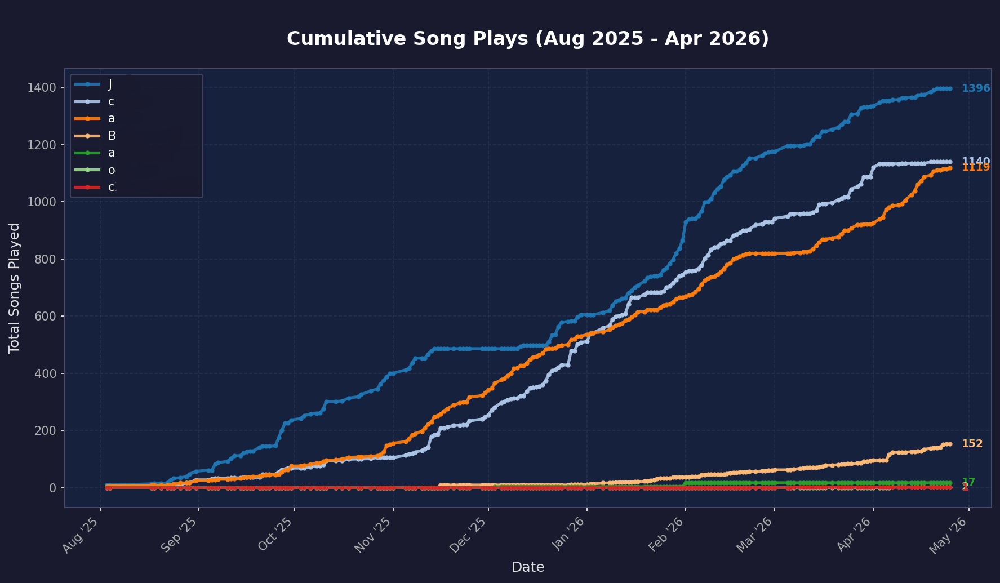

# Discord Music Bot

A personal Discord music bot built with `discord.py`, `yt-dlp`, FFmpeg, and SQLite. It primarily plays music from YouTube search results or direct YouTube links, with SoundCloud URLs also supported through `yt-dlp`.

I built this for my own Discord server, and I am open sourcing it mainly as a professional portfolio example rather than as a polished public product. It is shared as-is, and I do not expect to maintain it like a general-purpose bot for other communities.

## What It Does

*   Plays YouTube audio from search terms, selected search results, or direct URLs.
*   Supports SoundCloud URLs through the same `yt-dlp` backend.
*   Streams uncached songs immediately via `yt-dlp` piped into FFmpeg while downloading and caching eligible tracks in a low-priority background worker.
*   Caches downloaded songs and search results locally by default so repeated plays (and queued tracks that finish caching before their turn) start immediately with Opus passthrough and no duplicate YouTube lookups.
*   Applies configurable EBU R128 loudness normalization (two-pass linear normalization for cached downloads, real-time single-pass normalization for live streams).
*   Can run in a no-cache-download mode (`--no-cache` / `DISABLE_SONG_CACHE=true`) that reuses existing cached songs and streams uncached songs without background downloads.
*   Tracks every song request in a local SQLite database, including the requester, server, resolved title, URL, duration, and play status.
*   Uses that play history for stats commands, leaderboards, an animated leaderboard race, and cumulative play graphs.
*   Runs as a systemd user service with graceful shutdown and automatic restart on failure.
*   Automatically disconnects from empty or inactive voice channels.
*   Streams very long songs instead of downloading them, keeping cache size reasonable.
*   Limits the cache to 30 GB by default, warns when less than 1 GB remains, and streams uncached songs when full.

## Stats And Play History

Every song request is saved to an SQLite database. This history makes it possible to see who requests the most songs, how activity changes over time, and how the server leaderboard evolves.

The `!cg` command generates a cumulative song-play graph from the database:



The same database format is also designed to work with my related Last.fm automation project, [last-fm-auto](https://github.com/jackmanuel/last-fm-auto), which I intend to open source as well. That project uses the bot's play history as a source for automatic Last.fm scrobbling.

## Commands

The most commonly used commands are:

*   `!play <song name or URL>`: Searches YouTube or plays a YouTube/SoundCloud URL.
*   `!search <song name>`: Shows selectable YouTube results.
*   `!queue` or `!q`: Shows the current queue.
*   `!skip`: Skips the current song.
*   `!stats [@user]`: Shows request stats.
*   `!leaderboard` or `!lb`: Shows the top requesters.
*   `!songleaderboard` or `!songlb`: Shows the top 10 songs by completed plays.
*   `!cacheleaderboard` or `!cachelb`: Shows who in the current server is responsible for the most cached music by file size.
*   `!cg`: Generates a cumulative play graph.
*   `!leaderboardrace`: Generates an animated leaderboard race video.

See [docs/COMMANDS.md](docs/COMMANDS.md) for the full command reference.

## Setup

### Prerequisites

*   Debian (or another systemd-based Linux) with Python 3.10 or newer.
*   FFmpeg (`sudo apt install ffmpeg`).
*   A Discord bot token from the [Discord Developer Portal](https://discord.com/developers/applications).

### Installation

```bash
python3 -m venv .venv
.venv/bin/pip install -r requirements.txt
cp .env.example .env
```

Set your Discord bot token in `.env`:

```dotenv
DISCORD_BOT_TOKEN=YOUR_BOT_TOKEN_HERE
```

Optional settings, including a custom FFmpeg path, EBU R128 loudness normalization (`LOUDNORM_ENABLED`, target LUFS/true-peak/LRA, Opus bitrate), maximum cache download duration, and disabling new cache downloads (`DISABLE_SONG_CACHE=true`), are documented in `.env.example`.

### Running The Bot

The bot runs as a systemd user service, `~/.config/systemd/user/discord-music-bot.service`:

```ini
[Unit]
Description=Discord music bot
StartLimitIntervalSec=0

[Service]
Type=simple
WorkingDirectory=/home/jack/bots/python-music-bot
ExecStart=/home/jack/bots/python-music-bot/.venv/bin/python -u /home/jack/bots/python-music-bot/src/music_bot/music_bot.py
Environment="PATH=/home/jack/bots/python-music-bot/.venv/bin:/home/jack/.local/bin:/usr/local/bin:/usr/bin:/bin"
Environment=PYTHONUNBUFFERED=1
Restart=on-failure
RestartSec=15
KillSignal=SIGINT
TimeoutStopSec=45

[Install]
WantedBy=default.target
```

`KillSignal=SIGINT` makes the bot shut down gracefully when stopped.

Common commands:

```bash
systemctl --user daemon-reload                     # after editing the unit file
systemctl --user enable --now discord-music-bot    # start now and on login/boot
systemctl --user restart discord-music-bot
systemctl --user stop discord-music-bot
systemctl --user status discord-music-bot
journalctl --user -u discord-music-bot -f          # follow console output
```

The application log is written to `logs/music_bot.log` (rotated daily). Start and stop the bot and view its logs with the separate bot dashboard, or use the commands above.

## Project Structure

*   `src/music_bot/`: Bot source code and supporting Python modules.
*   `tests/`: Unit tests for the YouTube helpers, song cache, playback, queue, and stats commands.
*   `database/`, `logs/`, and `song_cache/`: Runtime data generated by the bot.

## Investigating Cache Usage

Run the interactive cache investigator to review large cached files with at most
one completed play:

```bash
.venv/bin/python src/music_bot/cache_investigator.py
```

Results are prioritized by the total number of database entries for a song, then
by file size. Matched filenames are clickable links to their YouTube pages in
terminals that support hyperlinks. Titles come from the database when available;
missing YouTube titles are looked up with yt-dlp without downloading media. After
the report, each displayed file has a yes/no deletion prompt, defaulting to no.
Partial downloads, SoundCloud files, and unrecognized names are listed separately
because the current database cannot safely associate them with a cache ID.

Use `--limit 50` to show more results or `--max-plays 0` to show only files with
no completed plays. Run with `--help` for path overrides and all options.
Use `--no-links` if the terminal displays hyperlink escape sequences incorrectly.
Use `--report-only` to disable deletion prompts.

Use `--largest` to ignore play counts, include every matched YouTube cache file,
and sort strictly from largest to smallest:

```bash
.venv/bin/python src/music_bot/cache_investigator.py --largest
```
